# SkyCampus-ECI-Giral
## Reto 6: Requerimientos funcionales, no funcionales y priorización MoSCoW

### 1. Requerimientos funcionales (RF)

Los requerimientos funcionales describen las acciones que el sistema debe permitir realizar a sus usuarios y los resultados observables que debe producir.

| ID | Actor | Requerimiento funcional | Prioridad MoSCoW | Justificación |
|---|---|---|---|---|
| RF-01 | Operador de drones | El sistema debe permitir al operador consultar la lista de drones disponibles y visualizar la batería actual de cada uno. | Must Have | Es indispensable conocer la disponibilidad y batería de la flota para gestionar las misiones manualmente. |
| RF-02 | Solicitante | El sistema debe permitir al solicitante registrar una solicitud de reparto indicando el origen, el destino y el tipo de carga, y mostrar un código de identificación de la solicitud. | Must Have | Registrar solicitudes es una función central del MVP y permite identificar cada petición de reparto. |
| RF-03 | Operador de drones | El sistema debe permitir al operador consultar el historial de misiones del día, mostrando su identificador, origen, destino y estado. | Should Have | Facilita el seguimiento de las operaciones, aunque el MVP puede funcionar inicialmente sin esta consulta histórica. |

### 2. Requerimientos no funcionales (RNF)

Los requerimientos no funcionales establecen condiciones de calidad medibles y verificables para el sistema.

| ID | Requerimiento no funcional | Prioridad MoSCoW | Justificación |
|---|---|---|---|
| RNF-01 | El panel de monitoreo debe reflejar un cambio de estado de un dron en un máximo de 3 segundos, medidos desde que el sistema registra el cambio hasta que aparece en el panel. | Must Have | Permite que el operador consulte información actualizada de la flota durante la asignación manual. |
| RNF-02 | El sistema debe responder a las consultas de disponibilidad de la flota en un máximo de 2 segundos en el 95 % de las solicitudes, bajo una carga de hasta 20 consultas simultáneas y con una flota de hasta 100 drones. | Should Have | Ofrece una respuesta ágil en un escenario de uso definido, sin exigir optimizaciones avanzadas desde la primera versión. |
| RNF-03 | El sistema debe permitir registrar solicitudes de reparto con una tasa de éxito de al menos 99 % en 1.000 intentos de prueba, cuando los datos sean válidos y la base de datos esté disponible. | Must Have | El registro de solicitudes es esencial; las pruebas permiten comprobar que funciona de forma consistente en condiciones controladas. |

**Nota:** Las métricas propuestas para los RNF son objetivos iniciales del MVP. Deben verificarse mediante pruebas y ajustarse si la infraestructura real lo requiere.

### 3. Priorización MoSCoW

La técnica MoSCoW permite clasificar los requerimientos según su importancia para la primera versión del sistema.

- **Must Have:** requerimientos indispensables para que el MVP cumpla sus objetivos principales.
- **Should Have:** requerimientos importantes que pueden aplazarse temporalmente sin impedir el funcionamiento básico.
- **Could Have:** funcionalidades opcionales que aportan valor, pero no son necesarias para la primera versión.
- **Won't Have:** funcionalidades excluidas del alcance actual y reservadas para versiones futuras.

| Categoría | Requerimientos | Justificación |
|---|---|---|
| Must Have | RF-01, RF-02, RNF-01 y RNF-03 | La consulta de la flota, el registro de solicitudes y sus condiciones esenciales de funcionamiento son fundamentales para el MVP. |
| Should Have | RF-03 y RNF-02 | El historial y el rendimiento bajo carga mejoran la operación, pero pueden abordarse después de asegurar las funciones principales. |
| Could Have | Ninguno de los seis requerimientos seleccionados | Se podrían incorporar funcionalidades adicionales, como exportar reportes de misiones, en una iteración posterior. |
| Won't Have | Ninguno de los seis requerimientos seleccionados | La asignación automática y la optimización de rutas quedan fuera del alcance actual del MVP, según lo definido para SkyCampus. |

### 4. Conclusión

La priorización de los requerimientos permite enfocar el desarrollo de SkyCampus MVP en las funcionalidades esenciales: consultar los drones disponibles, registrar solicitudes de reparto y garantizar condiciones mínimas de actualización y registro. Los requerimientos secundarios permiten mejorar el seguimiento y el rendimiento sin ampliar innecesariamente el alcance inicial.

Las funcionalidades de asignación automática y optimización de rutas se mantienen fuera del MVP y se reservan para versiones posteriores del proyecto.

## Reto 7: Especificación del requerimiento funcional SC-01

### 1. Información general

| Campo | Descripción |
|---|---|
| **Código** | SC-01 |
| **Nombre** | Registrar misión de reparto de documento |
| **Actor principal** | Solicitante |
| **Objetivo** | Permitir al solicitante registrar una misión de reparto de documentos indicando el dron asignado, el origen, el destino y el tipo de carga. |
| **Precondiciones** | 1. Debe existir al menos un dron disponible con batería igual o superior al 30 %. 2. El origen y el destino deben estar registrados en el sistema. |

### 2. Datos de entrada

| Campo | Tipo de dato | Descripción |
|---|---|---|
| Drone asignado | `Drone(id:String, bateria:int, disponible:boolean, ubicacion:String, capacidadCargaKg:double)` | Dron seleccionado para realizar la misión, incluyendo sus atributos relevantes para la validación. |
| Origen | `String` | Ubicación desde la cual se recoge el documento. |
| Destino | `String` | Ubicación a la que debe entregarse el documento. |
| Tipo de carga | `Enum(DOCUMENTOS, PAQUETE_PEQUENO, PAQUETE_GRANDE)` | Clasificación de la carga que se transportará. |

### 3. Datos de salida

| Campo | Tipo de dato | Descripción |
|---|---|---|
| Código de misión | `String` | Identificador único generado por el sistema para la misión registrada. |
| Estado de la operación | `Enum(EXITOSA, RECHAZADA)` | Indica si la misión se registró correctamente o fue rechazada durante las validaciones. |

### 4. Flujo básico

1. El solicitante ingresa el origen, el destino y el tipo de carga, y selecciona el dron asignado.
2. El sistema verifica que el dron esté disponible y tenga batería igual o superior al 30 %.
3. El sistema valida que el origen y el destino estén registrados y que el dron tenga capacidad suficiente para transportar la carga.
4. El sistema registra la misión y genera un código único de identificación.
5. El sistema confirma el registro y presenta al solicitante el código de la misión.

### 5. Flujos alternos

**FA-01: Dron sin batería suficiente**

1. Durante la validación, el sistema detecta que el dron tiene menos del 30 % de batería.
2. El sistema rechaza el registro de la misión.
3. El sistema informa que el dron no cumple el requisito mínimo de batería y solicita seleccionar otro dron disponible.

**FA-02: Destino inválido**

1. Durante la validación, el sistema detecta que el destino no está registrado o no es válido.
2. El sistema rechaza el registro de la misión.
3. El sistema informa que el destino no es válido y solicita ingresar un destino registrado.

### 6. Reglas de negocio

- **RN-01 — Disponibilidad y asignación:** un dron no puede tener más de una misión activa simultáneamente.
- **RN-02 — Capacidad y batería:** un dron solo puede recibir una misión si tiene al menos un 30 % de batería y su capacidad de carga es igual o superior al peso de la carga transportada.

### 7. Resultado esperado

La misión queda registrada únicamente cuando se cumplen las validaciones requeridas. El solicitante recibe un código único para identificar la solicitud, mientras que las operaciones que no cumplen las condiciones establecidas son rechazadas con un mensaje que explica el motivo. 

## Reto 8: Identidad visual y diseño del panel de monitoreo

### 1. Manual de identidad visual de SkyCampus

El objetivo de la identidad visual de SkyCampus es transmitir confianza, profesionalismo y control tecnológico, manteniendo una interfaz clara para los operadores de drones.

#### 1.1. Paleta de colores

| Elemento | Color | Código HEX | Justificación |
|---|---|---|---|
| Color primario | Azul oscuro | `#17365D` | Transmite confianza, profesionalismo y control tecnológico. |
| Color secundario | Azul medio | `#2563EB` | Destaca las acciones principales y los elementos interactivos. |
| Fondo principal | Gris claro | `#F4F6F9` | Facilita la lectura y reduce el ruido visual. |
| Tarjetas | Blanco | `#FFFFFF` | Separa visualmente la información de cada dron. |
| Texto principal | Gris oscuro | `#1F2937` | Facilita la lectura de la información. |
| Texto secundario | Gris pizarra | `#64748B` | Diferencia etiquetas y datos complementarios. |

#### 1.2. Colores de estado

| Estado | Código HEX | Significado |
|---|---|---|
| Disponible | `#16A34A` | El dron puede recibir una misión si cumple las condiciones operativas. |
| En vuelo | `#2563EB` | El dron está ejecutando una misión. |
| En carga | `#CA8A04` | El dron está recuperando batería. |
| Fallo | `#DC2626` | El dron presenta un problema que requiere atención. |
| Batería insuficiente | `#EA5808` | El dron tiene menos del 30 % de batería y no cumple el mínimo para una nueva asignación. |

Los estados se identifican mediante texto y color para evitar que la interpretación dependa únicamente de la percepción cromática.

#### 1.3. Tipografía

- **Inter, peso 400:** textos, etiquetas y descripciones.
- **Inter, peso 600:** títulos, encabezados y datos destacados.
- **JetBrains Mono:** identificadores de drones y códigos de misión.

#### 1.4. Tono de voz

SkyCampus utiliza un tono técnico, profesional y directo. Los mensajes deben explicar claramente qué ocurrió y, cuando corresponda, qué acción debe realizar el operador.

Ejemplo:

> El dron D-04 tiene batería insuficiente (18 %). Mínimo requerido: 30 %.

### 2. Mock del panel de monitoreo de la flota

Se diseñó un mock de escritorio para el panel de monitoreo de SkyCampus, manteniendo la identidad visual definida y priorizando la consulta rápida de la información de la flota.

#### 2.1. Captura del diseño

<!-- Reemplazar la siguiente línea con la ruta de la imagen del mockup -->

**Panel de monitoreo de SkyCampus:**

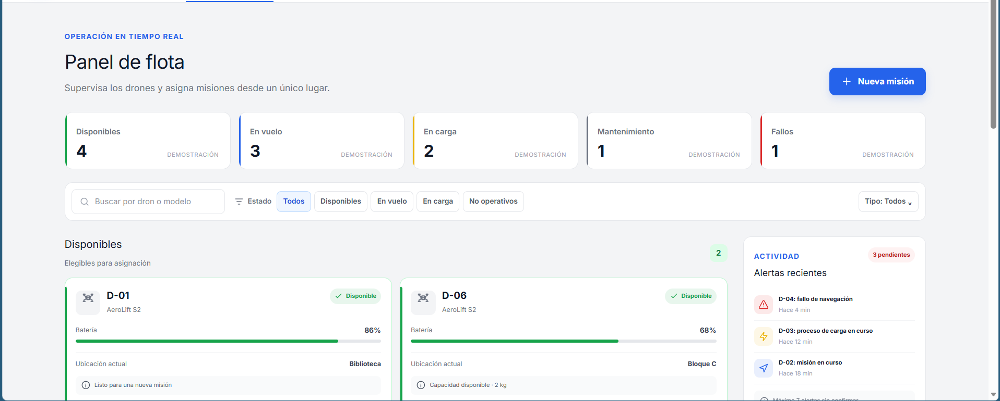

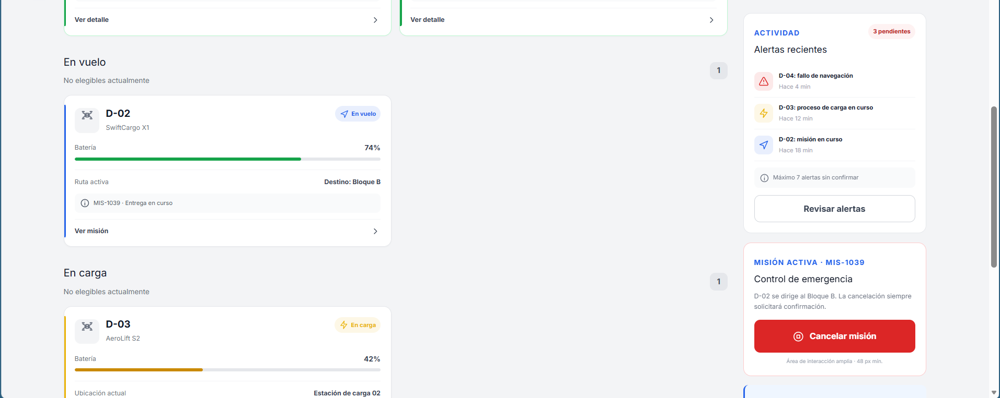

#### 2.2. Información presentada

El panel incluye una barra lateral de navegación, un encabezado, un resumen general de la flota y un listado de los cinco drones con sus identificadores, modelo, batería, estado y ubicación.

| ID | Modelo | Batería | Estado | Ubicación |
|---|---|---|---|---|
| D-01 | DJI Mini 3 | 85 % | Disponible | Bloque A |
| D-02 | DJI Mini 3 | 42 % | En vuelo | Biblioteca |
| D-03 | DJI Mini 3 | 91 % | Disponible | Bloque C |
| D-04 | DJI Mini 3 | 18 % | En carga | Bloque B |
| D-05 | DJI Mini 3 | 67 % | Disponible | Bloque D |

Los datos representan un escenario ilustrativo para el diseño del MVP.

### 3. Evaluación mediante las heurísticas de Nielsen

| N.º | Heurística | Aplicación en SkyCampus |
|---|---|---|
| 1 | Visibilidad del estado del sistema | El estado y el porcentaje de batería de cada dron se muestran directamente, sin necesidad de abrir otra pantalla. |
| 2 | Correspondencia entre el sistema y el mundo real | Se utilizan términos comprensibles como disponible, en vuelo y en carga. |
| 3 | Control y libertad del usuario | La cancelación de misiones pendientes debe contemplarse si esta funcionalidad forma parte del flujo implementado. |
| 4 | Consistencia y estándares | Los colores y las etiquetas de los estados se mantienen consistentes en toda la interfaz. |
| 5 | Prevención de errores | Las acciones de asignación se deshabilitan visualmente para drones no disponibles o con batería insuficiente. |
| 6 | Reconocimiento antes que recuerdo | El operador puede consultar el identificador, la batería, el estado y la ubicación sin memorizar información de otras pantallas. |
| 8 | Diseño estético y minimalista | Se prioriza la información necesaria para tomar decisiones operativas. |
| 9 | Ayuda para reconocer y recuperarse de errores | Los mensajes explican el motivo del rechazo, por ejemplo, cuando un dron no alcanza el mínimo de batería. |

### 4. Conclusión

La identidad visual de SkyCampus proporciona una base consistente para diseñar las interfaces del sistema. El panel de monitoreo prioriza la visibilidad del estado de los drones, la consulta de la batería y la prevención de asignaciones incorrectas.

El diseño mantiene el alcance del MVP: no incorpora servicios externos, control remoto ni optimización automática de rutas. La evaluación de las heurísticas permite identificar los aspectos de usabilidad que deben conservarse y verificarse en futuras iteraciones.

## Reto 9: Gestión del trabajo en Jira

### 1. Objetivo

Organizar el trabajo del MVP de SkyCampus mediante una jerarquía de actividades en Jira, incluyendo una épica, una feature y tres historias de usuario.

### 2. Jerarquía de actividades

- **Épica:** Desarrollo del MVP de SkyCampus.
- **Feature:** FEAT-01: Gestión de flota. Se representó mediante una tarea porque el proyecto de Jira no tenía disponible el tipo de actividad Feature.
- **HU-01:** Ver flota disponible.
- **HU-02:** Asignar drone a misión.
- **HU-03:** Cancelar misión pendiente.

### 3. Historias de usuario

**HU-01: Ver flota disponible**

Como operador, quiero consultar los drones disponibles, su nivel de batería y su ubicación, para identificar cuáles pueden recibir una nueva misión.

**HU-02: Asignar drone a misión**

Como operador, quiero asignar un dron disponible a una misión de reparto, para gestionar la entrega de manera segura y evitar asignaciones que no cumplan las condiciones operativas.

**Criterios de aceptación:**

1. Dado un dron disponible con batería igual o superior al 30 %, cuando el operador lo asigna a una misión válida, el sistema registra la asignación y el dron deja de aparecer como disponible para otra misión.
2. Dado un dron no disponible o con batería inferior al 30 %, cuando el operador intenta asignarlo, el sistema rechaza la operación e informa el motivo.

**HU-03: Cancelar misión pendiente**

Como operador, quiero cancelar una misión pendiente, para liberar el dron asignado cuando la entrega ya no sea necesaria.

### 4. Subtareas de HU-02

1. Implementar consulta de drones disponibles con batería mínima del 30 % usando Streams.
2. Implementar validación de disponibilidad y batería antes de asignar una misión.
3. Implementar el registro de la asignación y la actualización del estado del dron.

### 5. Evidencias

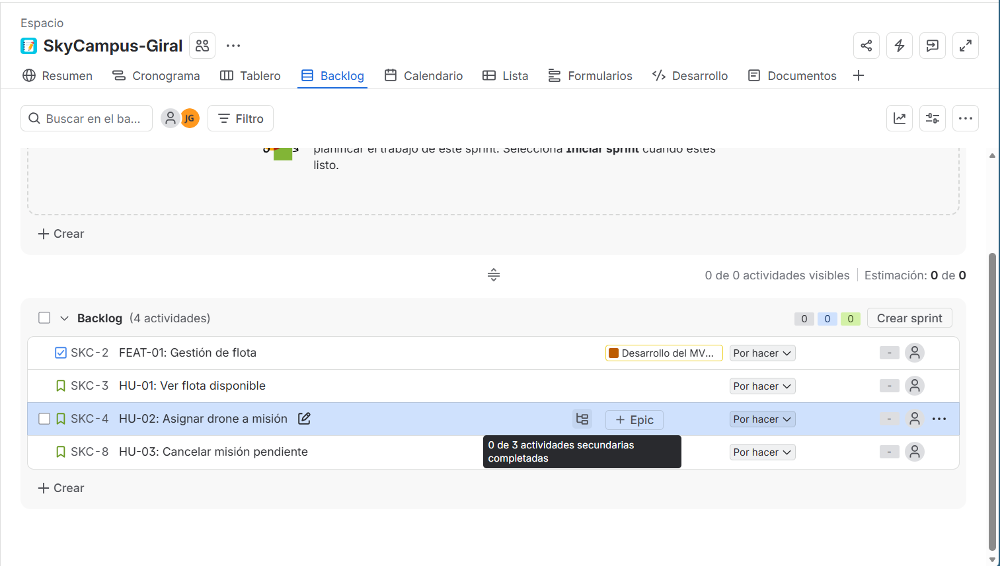
#### 
### 6. Conclusión

La organización del trabajo en Jira permite dividir el objetivo general de SkyCampus en funcionalidades e historias de usuario concretas. Las subtareas de HU-02 separan las responsabilidades técnicas de consulta, validación y registro de la asignación, facilitando el seguimiento y la implementación del trabajo.

## Reto 10: Diagrama de casos de uso

### Objetivo

Representar los casos de uso principales del MVP de SkyCampus, identificando los actores, las funcionalidades del sistema y las relaciones entre ellas.

### Actores

- **Operador:** consulta la flota disponible y participa en el registro y asignación de misiones.
- **Solicitante:** solicita una misión de reparto.
- **Admin:** puede cancelar misiones pendientes.

### Relaciones

- **`<<include>>`:** registrar una misión incluye validar la disponibilidad del dron y ejecutar las acciones necesarias para registrar y asignar la misión.
- **`<<extend>>`:** enviar una alerta de batería baja se ejecuta únicamente cuando se cumple la condición definida: batería inferior al 40 %.

### Evidencia del diagrama

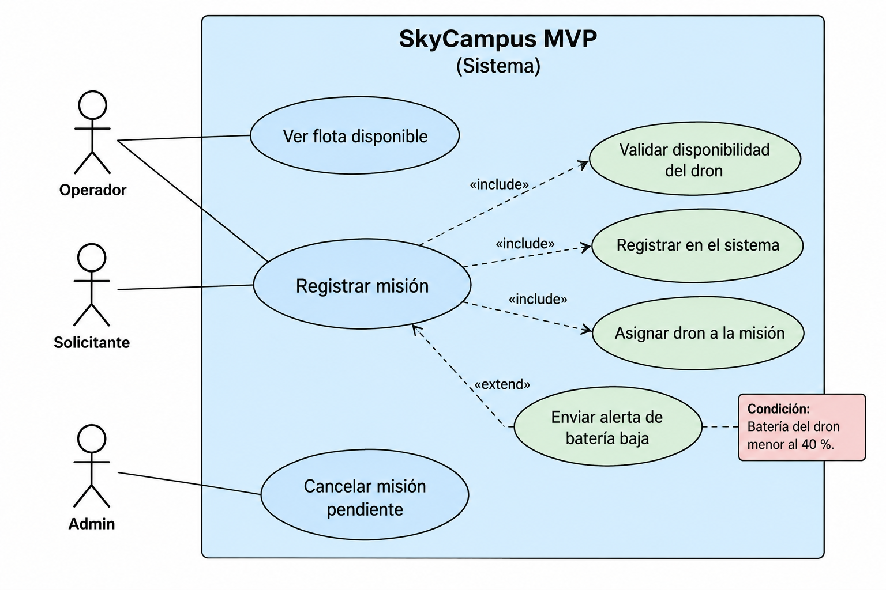

## Reto 11: Diseño del panel de monitoreo con IA

### 1. Objetivo

Diseñar un panel de monitoreo para SkyCampus utilizando inteligencia artificial, manteniendo la identidad visual definida previamente y teniendo en cuenta los datos del requisito funcional SC-01: Registrar misión.

### 2. Identidad visual aplicada

El diseño conserva la identidad visual establecida para SkyCampus.

| Elemento | Valor |
|---|---|
| Azul principal | `#17365D` |
| Azul de interacción | `#2563EB` |
| Fondo principal | `#F4F6F9` |
| Tarjetas | `#FFFFFF` |
| Texto principal | `#1F2937` |
| Texto secundario | `#64748B` |
| Disponible | `#16A34A` |
| En vuelo | `#2563EB` |
| En carga | `#CA8A04` |
| Fallo | `#DC2626` |
| Batería insuficiente | `#EA5808` |

**Tipografía:** Inter para títulos, etiquetas y textos; JetBrains Mono para identificadores de drones.

### 3. Datos utilizados del requisito SC-01

El panel muestra la información necesaria para que el operador consulte el estado de la flota y determine qué drones pueden recibir una misión.

| ID | Modelo | Batería | Estado | Ubicación |
|---|---|---:|---|---|
| D-01 | DJI Mini 3 | 85 % | Disponible | Bloque A |
| D-02 | DJI Mini 3 | 42 % | En vuelo | Biblioteca |
| D-03 | DJI Mini 3 | 91 % | Disponible | Bloque C |
| D-04 | DJI Mini 3 | 18 % | En carga | Bloque B |
| D-05 | DJI Mini 3 | 67 % | Disponible | Bloque D |

El mínimo operativo para asignar una nueva misión es del 30 % de batería. Los datos representan un escenario ilustrativo para el prototipo.

### 4. Estados del panel generados con IA

#### 4.1. Estado normal

Presenta la flota con drones disponibles, en vuelo y en carga. El operador puede identificar rápidamente la batería, el estado y la ubicación de cada dron.

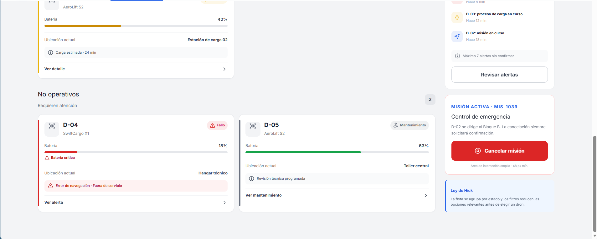

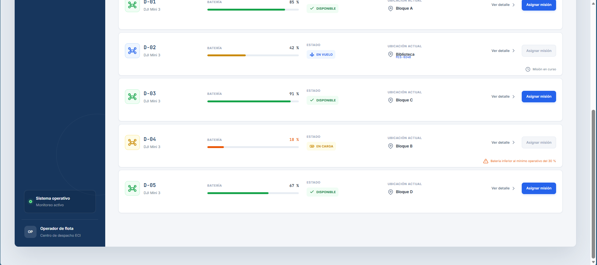

#### 4.2. Estado de alerta

Muestra un dron con estado de fallo, destacado mediante el color rojo, un mensaje de advertencia y la restricción de asignación de nuevas misiones.

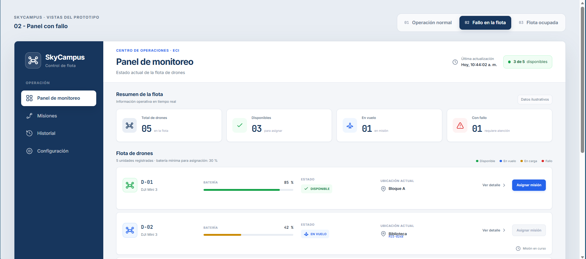

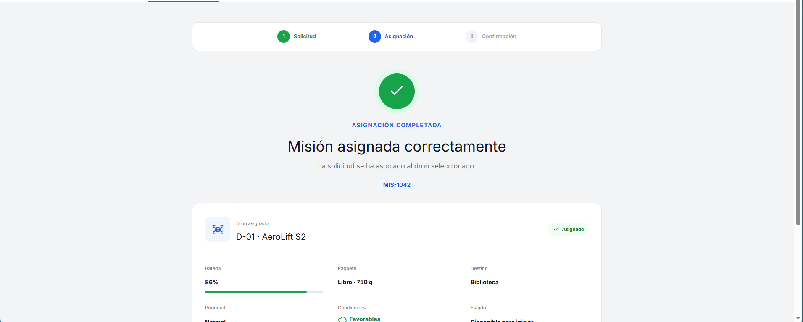

#### 4.3. Estado sin drones disponibles

Representa una situación en la que todos los drones están ocupados. El panel muestra cero drones disponibles y un mensaje que explica por qué no es posible asignar una nueva misión.

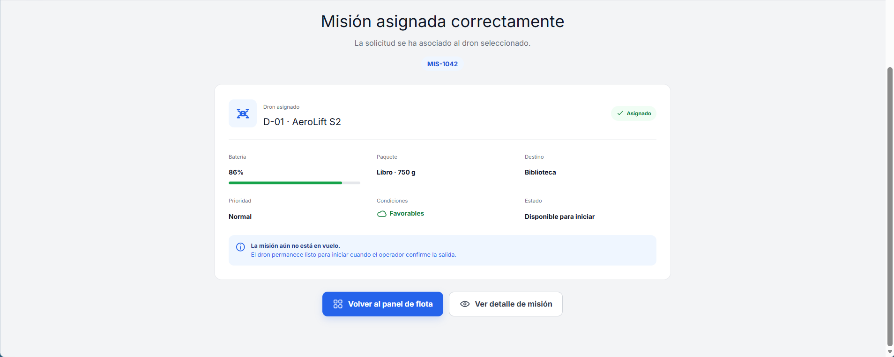

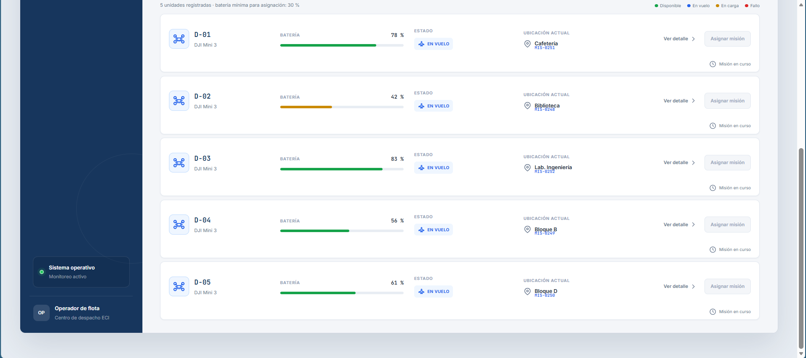

### 5. Evaluación mediante las heurísticas de Nielsen

| N.º | Heurística | Aplicación en SkyCampus |
|---|---|---|
| 1 | Visibilidad del estado del sistema | El operador puede consultar el identificador, la batería, el estado y la ubicación de cada dron directamente desde el panel. |
| 5 | Prevención de errores | La asignación se deshabilita para drones no disponibles o con batería inferior al 30 %, y se informa el motivo. |
| 8 | Diseño estético y minimalista | Se prioriza la información operativa, con tarjetas organizadas, colores consistentes y una jerarquía visual clara. |

### 7. Prompt utilizado

Se utilizó un prompt contextual para solicitar a la IA el diseño del panel de monitoreo de SkyCampus. El prompt especificó la identidad visual, los datos de los cinco drones, las acciones del operador, los tres estados de la interfaz y las heurísticas de Nielsen que debían considerarse.

El prompt completo se encuentra documentado como parte de la evidencia del reto.

### 8. Conclusión

El uso de inteligencia artificial permitió generar una propuesta visual del panel de monitoreo a partir de la identidad visual y los requisitos definidos para SkyCampus. La elaboración de los tres estados facilita evaluar cómo se presenta la información en situaciones normales, ante fallos y cuando no hay drones disponibles.

La evaluación basada en las heurísticas de Nielsen permite identificar aspectos importantes para la usabilidad, como la visibilidad de los estados, la prevención de asignaciones incorrectas y la presentación clara de la información.

Las pantallas generadas son prototipos visuales y no representan una integración funcional con la flota real.

## Reto 14: Análisis de calidad con SonarQube — Chimchar

### Objetivo
Integrar SonarQube con el proyecto SkyCampus-ECI para evaluar la calidad del código, identificar problemas de mantenibilidad y seguridad, y corregir los Code Smells detectados.

### Trabajo realizado
- Se configuró SonarQube para analizar el proyecto y se integró el reporte de cobertura generado por JaCoCo.
- Se ejecutaron análisis de calidad sobre la rama `feature/Chimchar`.
- Se corrigieron Code Smells relacionados con clases vacías, uso de `System.out.println()` y concatenación de cadenas en registros.
- Se implementaron las clases de estrategia para seleccionar el dron disponible con mayor batería.
- Se agregaron pruebas unitarias para aumentar la cobertura del código nuevo.
- Se ejecutó `mvn clean verify` para comprobar que la compilación y las pruebas fueran exitosas.

### Resultados obtenidos
- **Quality Gate:** Passed.
- **Cobertura del código nuevo:** 91,5 %.
- **Bugs nuevos:** 0.
- **Vulnerabilidades nuevas:** 0.
- **Code Smells nuevos:** 0.
- **Deuda técnica añadida:** 0.
- **Duplicación del código nuevo:** 0 %.

La cobertura aumentó del 35,6 % al 91,5 %, superando el objetivo del 80 % establecido para el reto.

### Evidencia de SonarQube

<!-- Insertar aquí la única captura del resultado final de SonarQube -->

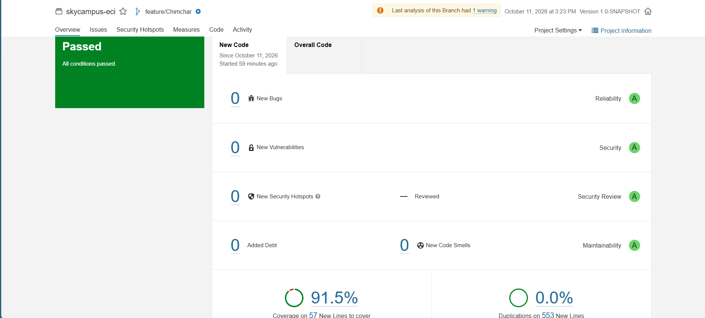

### Conclusión
La integración de SonarQube permitió evaluar la calidad y mantenibilidad del código de SkyCampus-ECI. Se implementaron mejoras, se añadieron pruebas unitarias y se alcanzó un 91,5 % de cobertura en código nuevo, con el Quality Gate aprobado. Queda pendiente revisar el Code Smell relacionado con el parámetro no utilizado.