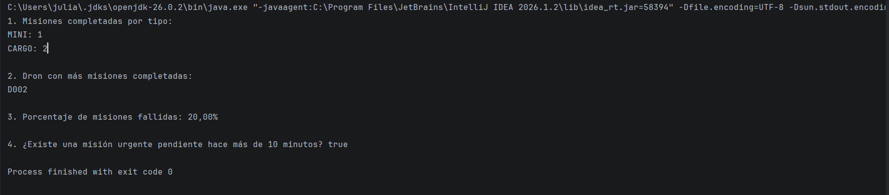
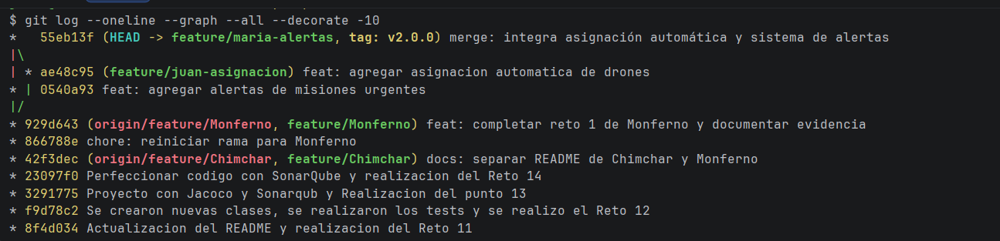
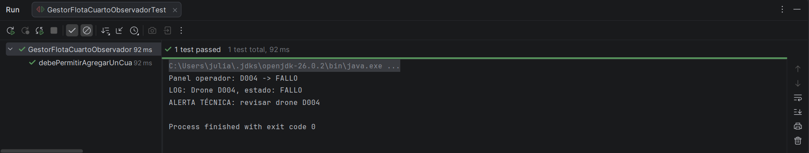
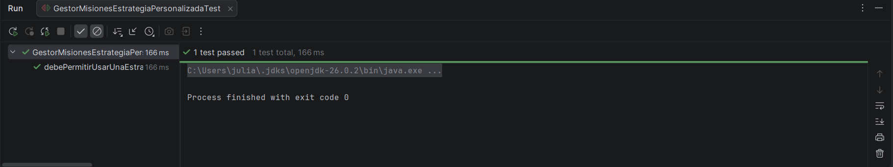
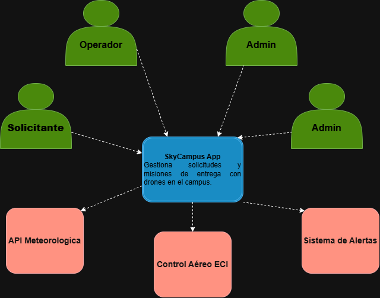

# SkyCampus — Monferno

### Reto 1. Streams & Lambdas: Estadísticas de misiones

#### Evidencia de ejecución

La siguiente evidencia muestra la ejecución exitosa del Reto 1 en IntelliJ IDEA, con los resultados de los cuatro puntos implementados.



**Resultado:** ejecución finalizada correctamente con `Process finished with exit code 0`.

## Reto 2. Git Merge: Resolución de conflictos y versionamiento

### Evidencia

Captura del historial de Git donde se observa el conflicto resuelto, el commit de integración y la convergencia de las ramas.



# Reto 3 — Patrones de diseño Strategy y Observer

## Objetivo

Implementar los patrones de diseño **Strategy** y **Observer** en SkyCampus para permitir diferentes estrategias de asignación de drones y notificar automáticamente los cambios de estado de la flota, favoreciendo un código mantenible, extensible y desacoplado.

## 1. Patrón Strategy

Se implementó la interfaz `EstrategiaAsignacion`, que permite definir diferentes criterios para seleccionar un dron según las características de una misión.

Las tres implementaciones desarrolladas son:

- **AsignacionMayorBateria:** selecciona un dron compatible con la misión que tenga el mayor nivel de batería.
- **AsignacionMenorUso:** selecciona un dron compatible considerando su cantidad de usos acumulados.
- **AsignacionTipoCompatible:** selecciona el tipo de dron con la capacidad adecuada para transportar la carga.

La clase `GestorMisiones` utiliza la interfaz `EstrategiaAsignacion` y permite cambiar la estrategia de asignación sin modificar su lógica principal.

### Pruebas de Strategy

Se verificó la selección mediante las estrategias implementadas y el cambio de estrategia en tiempo de ejecución.

## 2. Patrón Observer

Se implementó la interfaz `ObservadorDrone`, que define el mecanismo de notificación cuando cambia el estado de un dron.

Los tres observadores desarrollados son:

- **PanelOperador:** recibe las notificaciones de cambios de estado de la flota.
- **SistemaLog:** registra los eventos relacionados con los cambios de estado.
- **AlertaTecnico:** reacciona ante los estados que requieren atención técnica, especialmente cuando un dron presenta un fallo.

La clase `GestorFlota` administra la suscripción de observadores y notifica los cambios mediante la interfaz común, sin depender directamente de las clases concretas.

## 3. Extensibilidad del patrón Observer

Se creó una prueba automatizada para demostrar que es posible agregar un cuarto observador sin modificar la clase `GestorFlota`.

La prueba registra los tres observadores originales, incorpora un nuevo observador y comprueba que este recibe la notificación cuando el estado de un dron cambia a `FALLO`.

Esto demuestra que el sistema permite incorporar nuevos observadores mediante suscripción, sin alterar el código del gestor de la flota.

## 4. Principios SOLID aplicados

- **Open/Closed Principle (OCP):** Strategy permite agregar nuevas estrategias de asignación sin modificar `GestorMisiones`.
- **Dependency Inversion Principle (DIP):** Observer permite que `GestorFlota` trabaje con la abstracción `ObservadorDrone` en lugar de depender de implementaciones concretas.
- **Single Responsibility Principle (SRP):** cada estrategia y observador tiene una responsabilidad específica.

## 5. Pruebas y validación

Las pruebas automatizadas contemplan:

- Selección de drones mediante las estrategias de asignación.
- Cambio de estrategia en `GestorMisiones`.
- Gestión de suscripciones y notificaciones de cambios de estado.
- Incorporación de un cuarto observador sin modificar `GestorFlota`.

Para ejecutar todas las pruebas del proyecto, desde la raíz del repositorio, utilizar:

```bash
mvn clean test
```

La validación global se considera satisfactoria cuando Maven finaliza con `BUILD SUCCESS`.

## 6. Evidencia del reto

La captura de evidencia se almacena en la siguiente ruta del repositorio:



La evidencia debe mostrar la ejecución satisfactoria de las pruebas relacionadas con Strategy y Observer, incluida la prueba que verifica la incorporación del cuarto observador.

## Resultado

El reto permite aplicar dos patrones de diseño para separar los criterios de asignación de drones y desacoplar las notificaciones de cambios de estado. La solución facilita la extensión del sistema y reduce la necesidad de modificar clases existentes cuando se incorporan nuevos comportamientos.

## Reto 4. Aplicación de principios SOLID

### 1. Comparación entre el MVP y la arquitectura v2

#### SRP — Single Responsibility Principle (Responsabilidad única)

- **MVP:** `GestorDrone` violaba este principio porque concentraba múltiples responsabilidades, como asignar misiones, conectarse a MySQL, enviar correos, generar reportes PDF y calcular rutas.
- **Arquitectura v2:** las responsabilidades se distribuyeron en clases y servicios especializados. Por ejemplo, `AsignadorMision` se encarga de asignar misiones y `SistemaLog` de registrar eventos. De esta manera, cada componente tiene una responsabilidad más específica.

#### OCP — Open/Closed Principle (Abierto/cerrado)

- **MVP:** `GestorDrone` utilizaba condiciones para determinar el comportamiento según el tipo de ruta. Agregar un nuevo tipo requería modificar el código existente.
- **Arquitectura v2:** el patrón Strategy permite incorporar nuevas implementaciones de `EstrategiaAsignacion` sin modificar `GestorMisiones`. Así, el comportamiento puede extenderse mediante nuevas clases.

#### DIP — Dependency Inversion Principle (Inversión de dependencias)

- **MVP:** `GestorDrone` dependía directamente de detalles de infraestructura, como `DriverManager` y la conexión concreta a MySQL, lo que aumentaba el acoplamiento.
- **Arquitectura v2:** los componentes utilizan abstracciones como `EstrategiaAsignacion` y `ObservadorDrone`. Esto permite depender de contratos en lugar de acoplarse directamente a implementaciones concretas.

### 2. Evidencia de la prueba de extensibilidad

Se implementó una prueba automatizada que crea una nueva implementación de `EstrategiaAsignacion`, la inyecta en `GestorMisiones` y verifica que el gestor utiliza esa estrategia correctamente, sin necesidad de modificar su código.

**Captura de evidencia:**



## Reto 5. Diagrama de contexto C4 — SkyCampus v2

### Diagrama de contexto



## Reto 6. Requisitos funcionales y no funcionales — SkyCampus v2

### 1. Requisitos funcionales (RF)

Los requisitos funcionales describen las nuevas funcionalidades que se incorporan en SkyCampus v2.

| ID | Requisito funcional | Prioridad MoSCoW |
|---|---|---|
| RF-07 | El sistema debe asignar automáticamente el dron disponible con mayor batería para las misiones no urgentes. | Must Have |
| RF-08 | El sistema debe asignar a las misiones urgentes el dron disponible más rápido, independientemente de su nivel de batería, siempre que cumpla las condiciones de seguridad para volar. | Must Have |
| RF-09 | El sistema debe consultar la API Meteorológica antes de cada lanzamiento y verificar las condiciones de viento y lluvia para determinar si el vuelo es seguro. | Must Have |
| RF-10 | El sistema debe detectar cuando un dron entra en estado FALLO, enviar una alerta y permitir que el técnico de mantenimiento consulte el incidente y registre las acciones realizadas. | Must Have |

**Nota:** RF-07 y RF-08 conforman conjuntamente la funcionalidad de asignación automática. RF-09 corresponde a la consulta meteorológica y RF-10 contempla las alertas de fallo y la gestión del mantenimiento por parte del técnico.

### 2. Requisitos no funcionales (RNF)

Los requisitos no funcionales definen criterios medibles para evaluar el rendimiento, la confiabilidad y la trazabilidad de SkyCampus v2.

| ID | Requisito no funcional | Prioridad MoSCoW |
|---|---|---|
| RNF-01 | El algoritmo de asignación automática debe seleccionar el dron óptimo en menos de 500 ms para una flota de hasta 50 drones, medido mediante JUnit 5 y `assertTimeout`. | Must Have |
| RNF-02 | El sistema debe generar la solicitud de envío de una alerta en un máximo de 1 segundo desde que se registra el estado FALLO de un dron. | Must Have |
| RNF-03 | El sistema debe completar la consulta meteorológica en un máximo de 2 segundos en al menos el 95 % de las solicitudes, bajo condiciones normales de disponibilidad de la API externa. | Should Have |
| RNF-04 | El sistema debe registrar el 100 % de las acciones de mantenimiento realizadas, incluyendo el identificador del dron, la fecha, el técnico responsable y la descripción de la acción. | Must Have |

Las métricas de RNF-02, RNF-03 y RNF-04 son objetivos propuestos para el proyecto y deberán validarse mediante pruebas. El límite de 500 ms de RNF-01 corresponde al criterio indicado en el enunciado del reto.

### 3. Priorización MoSCoW

La técnica MoSCoW permite clasificar los requisitos de acuerdo con su importancia para la entrega de SkyCampus v2.

- **Must Have:** requisitos indispensables para la operación segura y el funcionamiento esencial del sistema.
- **Should Have:** requisitos importantes que podrían aplazarse si existen restricciones justificadas, sin comprometer las condiciones de seguridad.
- **Could Have:** funcionalidades deseables que aportan valor, pero no son esenciales para la entrega.
- **Won't Have (por ahora):** funcionalidades que quedan fuera del alcance de esta versión.

En esta propuesta, los requisitos de asignación, consulta meteorológica, alertas y gestión de mantenimiento son indispensables. RNF-03 se clasifica como Should Have porque el objetivo de rendimiento de la integración meteorológica puede negociarse; sin embargo, **la consulta de las condiciones meteorológicas y la validación de seguridad antes del lanzamiento siguen siendo obligatorias**.

### 4. Tensión entre RF-07 y RF-08

#### Descripción de la tensión

RF-07 establece que las misiones no urgentes deben recibir el dron disponible con mayor batería. RF-08 establece que las misiones urgentes deben recibir el dron disponible más rápido, independientemente de la batería.

Ambos requisitos no son contradictorios, pero existe una tensión entre sus criterios de selección: uno prioriza la batería y el otro la velocidad. Si no se define cuál tiene prioridad, el desarrollador podría implementar reglas de asignación inconsistentes.

#### Regla de resolución

1. **Validar disponibilidad y seguridad:** el sistema debe descartar los drones que no estén disponibles o que no cumplan las condiciones mínimas de seguridad para volar.
2. **Misión urgente:** seleccionar el dron más rápido entre los drones disponibles que cumplan las condiciones de seguridad, sin utilizar la batería como criterio principal de selección.
3. **Misión no urgente:** seleccionar el dron disponible con mayor batería entre los que cumplan las condiciones de seguridad.
4. **Sin drones aptos:** si ningún dron cumple las condiciones necesarias, el sistema no debe asignar un dron para el lanzamiento y debe informar que no hay opciones seguras disponibles.

Por lo tanto, **la urgencia determina el criterio de selección, pero nunca prevalece sobre las condiciones de seguridad del vuelo**.

### 5. Validación de los requisitos

Los requisitos se deben verificar mediante pruebas que comprueben tanto el comportamiento funcional como las métricas establecidas.

- **RF-07 y RF-08:** realizar pruebas unitarias con drones que tengan diferentes niveles de batería, velocidades y disponibilidad. Verificar que cada tipo de misión aplique el criterio correspondiente.
- **RF-09:** probar respuestas de la API Meteorológica que indiquen condiciones seguras e inseguras, así como errores y tiempos de espera.
- **RF-10:** verificar que el sistema genere alertas cuando un dron entra en estado FALLO y que el técnico pueda consultar el incidente y registrar las acciones de mantenimiento.
- **RNF-01:** medir el tiempo de ejecución de la asignación automática con JUnit 5 y `assertTimeout`, utilizando una flota de hasta 50 drones.
- **RNF-02:** comprobar que la solicitud de alerta se genere dentro del límite de 1 segundo desde el registro del fallo.
- **RNF-03:** medir el tiempo de respuesta de la consulta meteorológica y comprobar el cumplimiento del límite de 2 segundos en al menos el 95 % de las solicitudes bajo las condiciones definidas.
- **RNF-04:** verificar que todas las acciones de mantenimiento queden registradas con los campos obligatorios.

# Reto 7. Plantilla DOSW — Requisito funcional SC-07

## 1. Información general

**Código:** SC-07

**Nombre:** Asignar automáticamente dron a misión

**Actor principal:** Operador de drones.

**Descripción:** El sistema asigna automáticamente un dron apto a una misión de reparto, considerando las condiciones meteorológicas, la disponibilidad de la flota, la batería, la capacidad de carga y la estrategia de selección activa. Una vez realizada la asignación, se notifica a los observadores correspondientes.

## 2. Precondiciones

- Debe existir una solicitud de misión registrada con los datos del paquete y el destino.
- Debe existir una estrategia de selección de drones configurada y activa.
- El sistema debe tener acceso a la información de disponibilidad, batería y capacidad de los drones.
- Debe ser posible consultar las condiciones meteorológicas antes de autorizar el lanzamiento.

## 3. Datos de entrada

| Nombre | Tipo de campo | Reglas | Obligatorio |
|---|---|---|---|
| paquete | — | Contiene los datos del paquete que se transportará | Sí |
| paquete.peso | `Integer` | Entre 1 y 2000 gramos | Sí |
| paquete.tipo | `Enum(SOBRE,CARPETA,LIBRO,EQUIPO)` | Debe corresponder a un tipo permitido | Sí |
| paquete.prioridad | `Enum(URGENTE,NORMAL,BAJO)` | Determina la prioridad de la misión | Sí |
| destino | `Enum(BLOQUE_A,BLOQUE_B,BLOQUE_C,BLOQUE_D,BIBLIOTECA)` | Debe corresponder a un destino válido | Sí |

## 4. Datos de salida

| Nombre | Tipo de campo | Reglas | Obligatorio |
|---|---|---|---|
| droneAsignado | — | Dron seleccionado por el sistema según la estrategia activa | No (salida) |
| droneAsignado.id | `String` | Formato `D-XX` | No (salida) |
| droneAsignado.bateria | `Integer` | Porcentaje de batería del dron asignado | No (salida) |

Si la asignación no puede realizarse, el sistema debe informar el motivo y no devolver un dron asignado.

## 5. Flujo básico

1. El operador solicita la asignación automática de un dron para una misión registrada. El sistema recibe y valida los datos del paquete y el destino.
2. El sistema consulta la API Meteorológica para verificar las condiciones de viento y lluvia antes del lanzamiento.
3. El sistema filtra los drones disponibles y aptos, descartando aquellos que no cumplan las condiciones meteorológicas, el mínimo de batería, la capacidad de carga o las restricciones aplicables.
4. El sistema aplica la estrategia de selección activa a los drones aptos, valida nuevamente la disponibilidad y los requisitos de asignación, y asigna el dron seleccionado a la misión.
5. El sistema devuelve los datos del dron asignado y notifica a los observadores correspondientes, como el panel del operador y el sistema de registro.

## 6. Flujos alternativos

### FA-01. No hay drones disponibles o aptos

1. Durante el filtrado, el sistema comprueba que no existen drones que cumplan las condiciones necesarias.
2. El sistema cancela la asignación.
3. El sistema informa al operador que no hay drones disponibles o aptos para la misión.
4. No se registra ningún dron como asignado.

### FA-02. Condiciones climáticas adversas

1. El sistema consulta las condiciones meteorológicas.
2. La API indica que las condiciones no son seguras para volar, por ejemplo, debido a viento fuerte o lluvia incompatible con la operación.
3. El sistema impide continuar con la asignación destinada al lanzamiento.
4. El sistema informa al operador que la misión no puede lanzarse por condiciones meteorológicas adversas.

### FA-03. El paquete supera la capacidad máxima

1. El sistema compara el peso del paquete con la capacidad de carga de los drones disponibles.
2. Comprueba que ningún dron apto puede transportar el paquete.
3. El sistema no asigna un dron.
4. El sistema informa al operador que el paquete supera la capacidad disponible de la flota.

## 7. Reglas de negocio

**RN-01. Batería mínima:** un dron solo puede ser considerado apto para una asignación si tiene al menos un 30 % de batería.

**RN-02. Restricción del dron CARGO:** el dron de tipo CARGO no puede utilizarse para transportar paquetes cuyo peso sea inferior a 100 gramos.

**RN-03. Capacidad de carga:** un dron no puede ser asignado a una misión si el peso del paquete supera su capacidad máxima de carga.

**RN-04. Seguridad meteorológica:** no se debe autorizar el lanzamiento cuando las condiciones meteorológicas sean adversas.

**RN-05. Disponibilidad:** un dron no puede recibir una nueva misión si no está disponible para ejecutarla.

**RN-06. Estrategia de selección:** el sistema debe aplicar la estrategia activa únicamente después de filtrar los drones que cumplen las condiciones de aptitud.

## 8. Notificación a observadores

Una vez confirmada la asignación, el sistema debe notificar a los observadores registrados para que actualicen la información de la misión.

La notificación debe incluir, como mínimo:

- Identificador de la misión.
- Identificador del dron asignado.
- Estado actualizado de la asignación.

Si la asignación falla, el sistema debe informar el resultado sin notificar una asignación exitosa inexistente.

## 9. Criterios de aceptación

- **CA-01:** Dada una misión válida y al menos un dron apto, cuando se solicite la asignación automática, el sistema selecciona un dron mediante la estrategia activa y devuelve sus datos.
- **CA-02:** Dado un dron con menos del 30 % de batería, cuando se evalúe su aptitud, el sistema lo descarta.
- **CA-03:** Dado un paquete de menos de 100 gramos, cuando se evalúe un dron CARGO, el sistema no lo selecciona.
- **CA-04:** Dadas condiciones meteorológicas adversas, cuando se consulte el clima, el sistema impide continuar con el lanzamiento e informa al operador.
- **CA-05:** Dado que ningún dron tiene capacidad suficiente para el paquete, cuando se intente la asignación, el sistema informa que no existe una opción apta.
- **CA-06:** Dada una asignación exitosa, cuando el sistema confirme el dron seleccionado, los observadores reciben la notificación correspondiente.